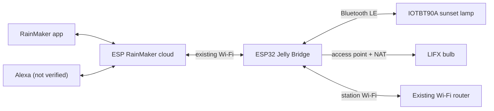

# ESP32 LIFX and Sunset Lamp Bridge

This project gives an ESP32 two jobs: connect to the home Wi-Fi and provides an access point for devices that cannot reach the internet on an isolated network (such as enterprise Wi-Fi), and it controls an IOTBT90A sunset lamp over Bluetooth LE. The lamp is exposed to ESP RainMaker as "Sunset Lamp" and Echo devices can stay on the existing Wi-Fi because RainMaker commands go through the ESP32's cloud connection.

## Build and flash

1. Install PlatformIO Core.
2. Copy `src/private_config.example.h` to `src/private_config.h` and set the
   access-point name and a unique password. `private_config.h` is ignored by
   Git.
3. Build with `pio run`.
4. Connect the ESP32, then flash with
   `pio run -t upload --upload-port <serial-port>`.
5. Open the serial monitor at 115200 baud. Use the ESP RainMaker app to add the
   device over Bluetooth, then give it the existing Wi-Fi name and password.
   After provisioning, the bridge starts its access point and scans for the
   sunset lamp. Keep the lamp powered and nearby.

## What's controlled

Power, brightness, hue, and saturation can be controlled via RainMaker. Using the ESP RainMaker Alexa skill, the device appears as a native device. The ESP32 uses AP-plus-station mode on one radio, so it follows the upstream AP's channel and shares airtime.
